

  

  <a href="https://huggingface.co/soleroa">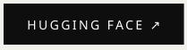</a>
  <a href="https://landcap.dev">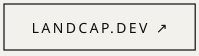</a>

  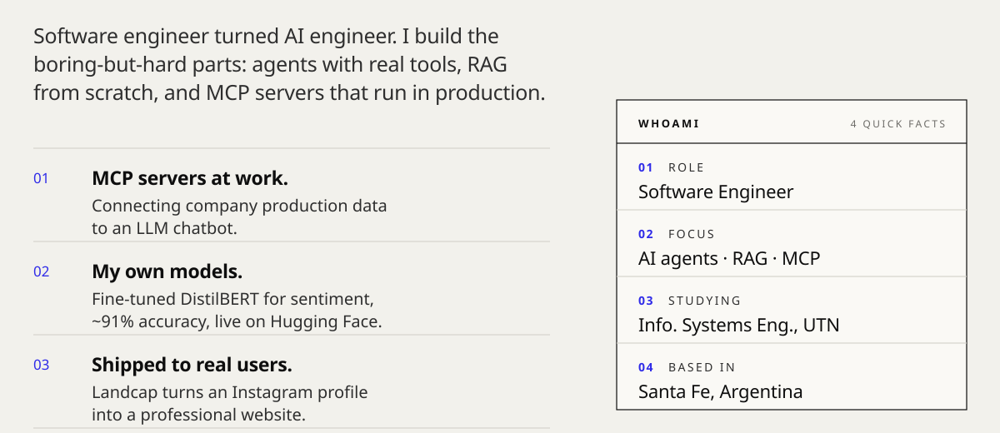

  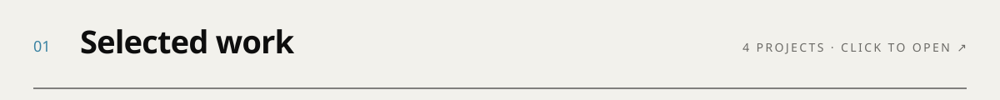
  <a href="https://github.com/soleroa/CineMatch">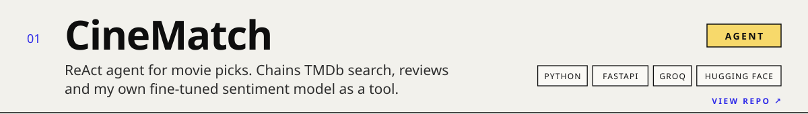</a>
  <a href="https://github.com/soleroa/alquilAI">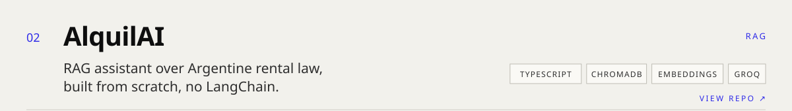</a>
  <a href="https://github.com/soleroa/legisbot">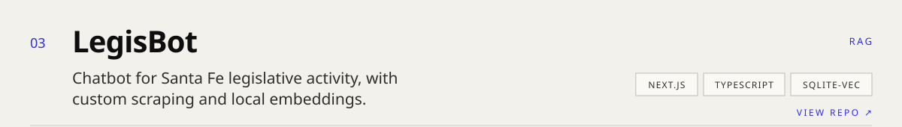</a>
  <a href="https://github.com/soleroa/llm-chat-cli">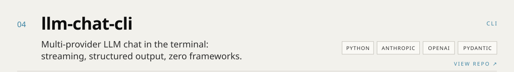</a>

  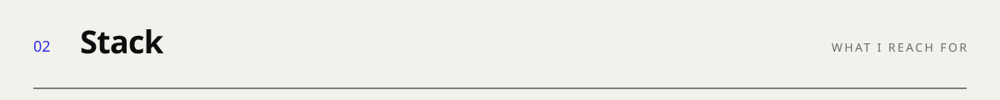
  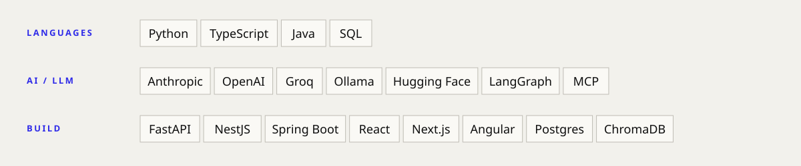

  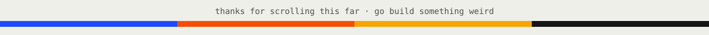

